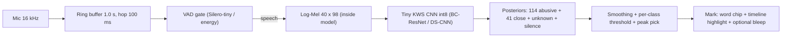
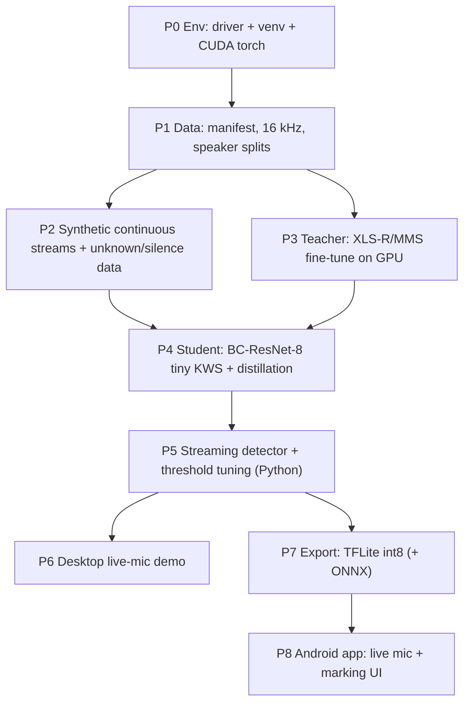

# BAAD — On-Device Live Abusive-Word Detector: Analysis + Training Plan (v2)

## 1. Goal

Build a **lightweight model that runs on a mobile phone**. It listens to the **live microphone**, detects Bangla abusive words inside **fluent sentences**, and **marks** them: which word, where in time, and a highlight on screen (optionally a bleep).

Requirements:
- **< 1 MB** int8 model
- **< 15 ms** inference per 100 ms hop on a mid-range phone
- **≈ 300–500 ms** detection latency
- low false alarms on normal speech

---

## 2. Hardware Check (re-done properly)

| Item | Finding |
|---|---|
| GPU | **NVIDIA GeForce GTX 1660 Ti (TU116, 6 GB)**. It is present. |
| Why `nvidia-smi` failed | The open-source **`nouveau`** driver is loaded. Only `nvidia-utils-565` (userspace tools) is installed, without the NVIDIA kernel driver, so `/dev/nvidia*` doesn't exist. |
| System | Ubuntu 22.04.5, kernel 6.8, 24 CPU threads, 31 GB RAM, Python 3.10 |

> [!IMPORTANT]
> **You need to run this yourself** (it needs `sudo` and a reboot, which I can't do from here):
> ```bash
> sudo apt purge -y 'nvidia-utils-565'
> sudo apt update
> sudo apt install -y nvidia-driver-570      # stable for Turing; or: sudo ubuntu-drivers install
> sudo reboot
> nvidia-smi                                   # should now show GTX 1660 Ti
> ```
> If Secure Boot is on, the installer will ask for a MOK password. Enroll it on the blue screen after reboot. After this I'll install PyTorch with CUDA (`pip install torch torchaudio --index-url https://download.pytorch.org/whl/cu124`) in a project venv.

A 1660 Ti is **more than enough**. The tiny mobile model trains in minutes. The larger teacher model (XLS-R/MMS-300M, fp16, batch ≈ 8–16) is feasible but slower; see §5.

---

## 3. Paper & Dataset Analysis (summary)

- **The paper only describes the data.** There is no model, split or baseline. It has 114 abusive words and 43 (41 present locally) close-sounding clean words, collected by **reading word lists with ~1 s pauses** and cutting at silences.
- **Local data:** 5,262 abusive clips (60 speakers) + 824 close-word clips (23 speakers). That is ≈ 74 min, ≈ 47 clips per word, 0.2–3.3 s each (median 0.7 s). Sample rates are mixed (16/22/44.1/48 kHz, one 32-bit set), so everything is resampled to 16 kHz mono.
- **Speaker key = filename prefix** (`10_chunk1.wav` → speaker 10). The metadata `spaker_id` is unique per clip and can't be used for grouping. Splits are **by speaker**.
- **Raw Data** holds the full recordings the clips were cut from, with words separated by pauses. Held-out speakers' raw files give a **free, realistic continuous test set**: the expected detections are the word list, in order.

> [!IMPORTANT]
> **The core gap:** BAAD has only isolated words. A live, in-sentence detector must also learn (1) what *normal* Bangla speech sounds like, so it can ignore it, and (2) what a keyword sounds like *without silence around it*. So training will add **external Bangla speech** and **synthetic continuous streams**.

---

## 4. Why This Architecture (mobile + live)

A full speech recognizer (Whisper/wav2vec2 ASR) is too big and slow for Bangla on a phone. The standard on-device solution is **streaming keyword spotting (KWS)**. A tiny CNN runs on a sliding 1 s window every 100 ms and outputs a probability for each target word plus "other speech" and "silence". "Okay Google" / "Hey Siri" work the same way.



| Candidate student model | Params | int8 size | Notes |
|---|---|---|---|
| **BC-ResNet-1 / 2** | ~10–30 K | < 100 KB | State-of-the-art tiny KWS; may be too small for 157 classes |
| **BC-ResNet-8** | ~320 K | ~400 KB | **Primary choice**: strong accuracy, still tiny |
| DS-CNN-L | ~420 K | ~500 KB | Well proven, very easy to export to TFLite |
| MatchboxNet 3x2x64 | ~90 K | ~150 KB | 1D conv option |

**Teacher-student distillation:** about 47 clips per word is very little for a model trained from scratch. A large pretrained **teacher** (XLS-R / MMS-300M fine-tuned on BAAD, trained on the GPU, *never shipped*) produces soft labels. The tiny **student** learns from those soft labels plus the true labels. This typically adds several points of accuracy for free on the phone.

"Marking in the sentence": there's no full transcript on the phone, so marking means **timestamped events** on a live scrolling waveform/timeline, labelled with the Bangla word, plus a list of detections. An optional "bleep/mute" mode replaces the detected segment in recorded audio.

---

## 5. Phased Plan



### P0 — Environment
- Fix the driver (§2). Create `baad_kws/.venv` and install: `torch`, `torchaudio` (CUDA), `transformers`, `librosa`, `soundfile`, `pandas`, `openpyxl`, `scikit-learn`, `sounddevice` (live mic), `silero-vad`, `onnx`, `onnxruntime`, `ai-edge-torch` (PyTorch→TFLite) or `onnx2tf`, `pyyaml`, `matplotlib`, `pytest`.

### P1 — Data pipeline
- `build_manifest.py` writes `path, label, label_id, is_abusive, subset, speaker (a10 / c7), sr, duration`. It normalises folder names (`"10. চুতমারানি"` → `চুতমারানি`).
- `preprocess.py`: 16 kHz mono float, loudness normalisation, trim with a 50 ms pad.
- `splits.py`: about 70/15/15 split **by speaker**, gender-balanced. Speakers with very few clips (13, 14, 4, 38) go into train only.

### P2 — Continuous / "sentence" training data
- **Background Bangla speech** (needs download): **OpenSLR-53** (large Bengali ASR corpus) and/or **Google FLEURS-bn** / **Common Voice-bn**. Optional **MUSAN** noise + RIRs for robustness.
- **Synthetic streams** of 5–15 s: real Bangla sentences with 0–3 BAAD clips spliced in (crossfade, −50 to 300 ms gaps, gain matching, noise/RIR), each with an exact label file `[{word, start, end, abusive}]`. Splice only clips from **same-split speakers**.
- **`_unknown_`** = 1 s crops of background speech plus close words if they aren't reported. **`_silence_`** = noise/silence crops.
- **Window labelling:** a 1 s window gets a word's label if ≥ 60% of the word is inside it. This teaches the model to fire when the word is centred in the window.

### P3 — Teacher (GPU, offline only)
- `facebook/mms-300m` or `wav2vec2-xls-r-300m` plus a pooling head, trained on the P2 windows with fp16 and gradient accumulation. Its output is soft labels for every training window.

### P4 — Student (the mobile model)
- Input: 40-bin log-Mel, 25 ms / 10 ms, 1 s → 40×98. **Feature extraction is built into the exported graph**, so phone and training compute exactly the same features.
- BC-ResNet-8, with DS-CNN-L as a fallback. Loss = CE(true label) + KD(teacher, temperature T). Augmentation: SpecAugment, speed 0.9–1.1, noise, time shift, gain.
- **Quantisation-aware fine-tuning** at the end so int8 accuracy matches float.

### P5 — Streaming detector (Python reference)
```text
every 100 ms: window = last 1.0 s of audio
  if VAD(window) == silence: skip
  p = student(window)                  # [157]
  p_s = mean(p over last 3-5 hops)     # smoothing
  for c in abusive_classes:
     if p_s[c] > thr[c] and is_peak and not in refractory(0.5 s):
         emit {word, start≈t-0.8 s, end≈t, score}
```
- `thr[c]` is tuned on **validation speakers** to hit a target false-alarm rate (e.g. ≤ 2 FA/h on clean Bangla speech).

### P6 — Desktop live-mic demo
- `python -m baad.live` uses `sounddevice` to show a scrolling waveform with **red highlights** and Bangla word labels for detected abusive words. It runs the **exported int8 model** via the TFLite / ONNX runtime, so the same file as on the phone is tested.

### P7 — Export for mobile
- PyTorch → **TFLite int8** (via `ai-edge-torch`, or ONNX → `onnx2tf`). An ONNX copy is kept as a fallback.
- Parity test: the float model, the int8 TFLite model and the Python streaming detector agree on the test streams within tolerance.
- Benchmark size, latency and RAM with the TFLite `benchmark_model` tool.

### P8 — Android app (Kotlin, TFLite) — ⏸ POSTPONED (decide after the model is done)
- `AudioRecord` at 16 kHz → ring buffer → TFLite interpreter (XNNPACK, 2 threads) → same smoothing/threshold logic → UI:
  - a live scrolling timeline with abusive segments highlighted red;
  - a "chip" list of detected words with time and confidence;
  - an optional bleep/vibrate and a log export.
- Runs fully **offline / on-device**, which is better for privacy.

---

## 6. Project Layout (new; the dataset folder stays read-only)

```
BAAD/baad_kws/
├── requirements.txt
├── configs/        teacher.yaml, student_bcresnet8.yaml, synth.yaml, detect.yaml
├── src/baad/
│   ├── data/       build_manifest.py, preprocess.py, splits.py, augment.py, synth_stream.py
│   ├── features.py               # log-Mel module (exported inside the model)
│   ├── models/     bcresnet.py, dscnn.py, teacher_ssl.py
│   ├── train_teacher.py, train_student.py (KD + QAT)
│   ├── detector.py               # streaming logic (reference implementation)
│   ├── evaluate.py               # word + event metrics, FA/h, DET curves
│   ├── export.py                 # TFLite int8 / ONNX + parity checks
│   └── live.py                   # desktop live-mic demo
├── tests/          test_manifest.py, test_splits_no_leak.py, test_synth_labels.py, test_detector.py, test_export_parity.py
├── android/        (P8) Kotlin app: AudioRecord + TFLite + marking UI
└── data/           (generated) manifest.csv, splits/, processed/, synth/, external/
```

---

## 7. Metrics & Success Criteria

| Level | Metric | Initial target |
|---|---|---|
| Word (isolated, unseen speakers) | macro-F1, binary abusive P/R | student ≥ 85% abusive recall |
| Abusive vs close pairs | pairwise confusion | report and minimise |
| Continuous (synthetic + Raw Data) | event F1 @ ±0.5 s, miss rate | event F1 ≥ 0.8 |
| False alarms | FA per hour on clean Bangla speech | ≤ 2–5 FA/h |
| Mobile | int8 size / latency per hop / RAM | < 1 MB / < 15 ms / < 30 MB |

> [!WARNING]
> Synthetic splicing doesn't fully reproduce co-articulation in real fluent speech. For an honest final number, please **record ~50–100 natural sentences from 5+ new speakers** containing some of these words. I'll provide a simple labelling format.

---

## 8. Decisions & Open Questions

**Decided (your feedback):**
- ✅ **Scope = model + desktop live-mic test only (P0–P7).** The Android app (P8) is postponed until the model is finished.
- ✅ **Visual marking only.** No bleeping or muting.

**Downloads, clarified.** Nothing big goes on the phone. Only the **tiny model (< 1 MB)** is shipped. The downloads are *training material*:

| Download | Size | Why | Needed? |
|---|---|---|---|
| Bangla speech (FLEURS-bn, a few hours) | ~1–2 GB | Examples of **normal Bangla sentences** so the model learns *not* to mark ordinary speech, and audio to build "sentences with an abusive word inside" | **Yes**: without it, false marks on normal speech will be very high |
| Silero VAD | ~2 MB | Skips silence (saves CPU) | Small; an energy-based VAD can replace it |
| Teacher model (XLS-R/MMS-300M) | ~1.2 GB | Helps the tiny model learn better from little data (+ a few % accuracy) | **Optional**: Plan A trains the tiny model directly, with no teacher |
| MUSAN noise | ~11 GB | Background-noise robustness | **Optional**: can use synthetic noise instead |

> [!IMPORTANT]
> **Q1 — Downloads:** Option **Minimal**: FLEURS-bn only (~1–2 GB); the teacher is added later only if accuracy is low. Option **Full**: FLEURS-bn + teacher + MUSAN. *Recommended: Minimal.*

> [!IMPORTANT]
> **Q2 — What to mark** (example sentence: "তুই একটা **কুত্তা**, ওর **কুকুর** টা সুন্দর"):
> - **A. Specific word (recommended):** the screen shows a red mark on "কুত্তা" with the label `কুত্তা – abusive`. "কুকুর" (dog, clean) is **not marked**.
> - **B. Generic tag:** the screen shows a red mark labelled just `abusive word`. It doesn't say which word. This is slightly more robust, because similar words being confused doesn't matter.
> - **C. Show close words too:** "কুত্তা" gets a red mark and "কুকুর" gets a yellow `clean (close)` mark. This is mainly useful for debugging.
>
> In all options the close words are **used in training** to teach the model the difference. They are just not shown as abusive.

---

## 9. Verification Plan

### Automated
- `pytest baad_kws/tests` checks:
  - the manifest has 5,262 + 824 clips;
  - **no speaker overlap** between splits;
  - all audio is 16 kHz mono;
  - synthetic labels are sample-exact;
  - the detector finds a known spliced word at the right time;
  - **export parity** between float and int8 TFLite.
- Smoke run: `python -m baad.train_student --config configs/student_bcresnet8.yaml --smoke`.

### Evaluation reports
- Word metrics, confusion matrix, event F1, FA/h, DET curve on test-speaker synthetic streams and held-out `Raw Data` recordings.
- TFLite size and latency benchmark.

### Manual
- Desktop live demo: speak normal Bangla sentences (expect no marks) and sentences containing abusive words (expect red marks with the correct word).
- On the phone (P8): the same test, with latency and battery observed.
